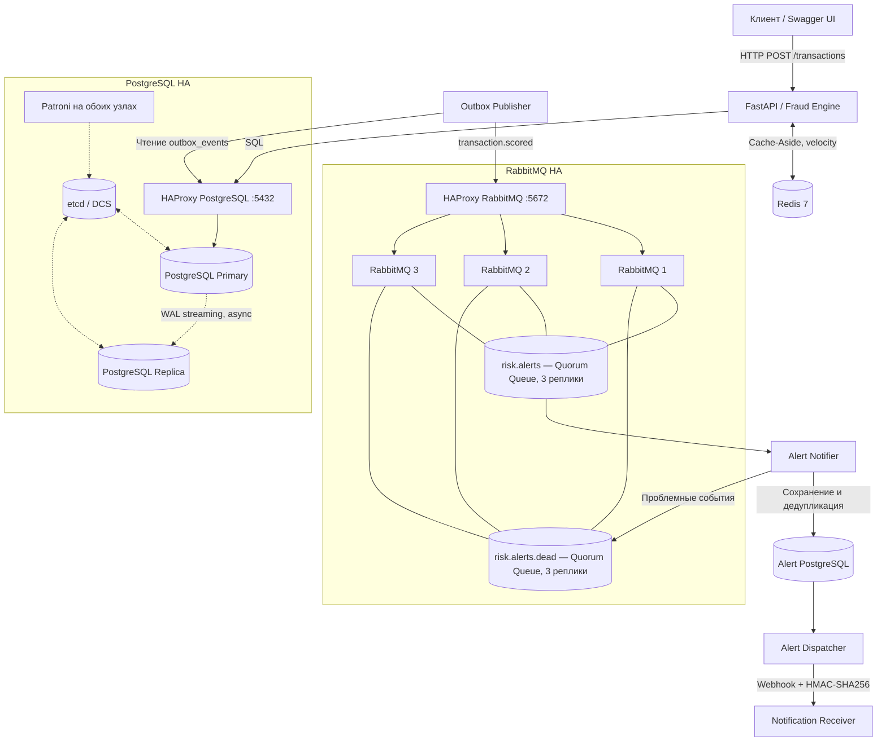

# Risk Engine — микросервисная антифрод-система


[](LICENSE)

**Risk Engine** — учебная микросервисная система для оценки мошеннического риска платёжных транзакций. Она принимает платежи через HTTP API, применяет набор объяснимых антифрод-правил, сохраняет результаты в PostgreSQL и передаёт события другим сервисам через RabbitMQ. При выявлении рискованной операции формируется уведомление, доставляемое по HTTP с HMAC-подписью.

В рамках дисциплины **«Безопасность высоконагруженных систем»** исходный проект дополнен сетевой сегментацией, средствами защиты взаимодействий, отказоустойчивыми PostgreSQL и RabbitMQ, резервным копированием и экспериментальной проверкой сценариев отказа.

> **Статус:** работающий учебный прототип на одной виртуальной машине Ubuntu с Docker Compose. Отказоустойчивость отдельных контейнеров подтверждена испытаниями; устойчивость к отказу всей виртуальной машины не обеспечивается.

Проект основан на [jmello04/risk-engine](https://github.com/jmello04/risk-engine). Исходный движок оценки риска и его правила сохранены, а микросервисная инфраструктура и механизмы надёжности развиты в рамках учебной работы.

## Содержание

- [Возможности](#возможности)
- [Архитектура](#архитектура)
- [Компоненты](#компоненты)
- [Алгоритм обработки транзакции](#алгоритм-обработки-транзакции)
- [Высокая доступность](#высокая-доступность)
- [Сетевая безопасность](#сетевая-безопасность)
- [Запуск и проверка стенда](#запуск-и-проверка-стенда)
- [Пример работы API](#пример-работы-api)
- [Резервное копирование и восстановление](#резервное-копирование-и-восстановление)
- [Испытания отказоустойчивости](#испытания-отказоустойчивости)
- [Параметры обслуживания](#параметры-обслуживания)
- [Тестирование и SQL](#тестирование-и-sql)
- [Структура проекта](#структура-проекта)
- [Ограничения](#ограничения)

## Возможности

- Оценка транзакций через `POST /transactions` с вычислением `fraud_score` и `risk_level`.
- Пять антифрод-правил и объяснение результатов каждого правила.
- Идемпотентная повторная отправка транзакции с тем же `transaction_id`.
- PostgreSQL для транзакций, результатов оценки, предупреждений и событий Outbox.
- Redis для временных счётчиков активности и кэширования чтения по схеме **Cache-Aside**.
- **Transactional Outbox** для сохранения события в одной транзакции БД вместе с результатом оценки.
- Асинхронная передача событий через RabbitMQ с подтверждением публикации и дедупликацией у потребителя.
- Отдельная база для обработанных событий и уведомлений.
- Webhook-доставка с **HMAC-SHA256**, повторными попытками и защитой от повторной обработки.
- PostgreSQL Primary/Replica под управлением **Patroni + etcd**, доступ к текущему Primary через **HAProxy**.
- Кластер из трёх узлов **RabbitMQ** с реплицируемыми **Quorum Queue** и HAProxy.
- Резервное копирование обеих баз и проверенное восстановление из дампов.
- Docker-сегментация и дополнительные правила `iptables` с применением через systemd.

## Архитектура



Схема показывает логические зависимости. Фактическое размещение и связи определяются файлами Docker Compose. Роли PostgreSQL Primary и Replica могут меняться после переключения Patroni; названия Docker-контейнеров не обозначают постоянные роли.

### Обмен событиями

1. FastAPI принимает транзакцию и рассчитывает риск.
2. Результат и событие `transaction.scored` атомарно фиксируются в основной PostgreSQL: таблицы `transactions` и `outbox_events`.
3. Outbox Publisher находит неопубликованные события, отправляет их в RabbitMQ через HAProxy и после подтверждения заполняет `published_at`.
4. Alert Notifier получает событие из `risk.alerts`, исключает повторную обработку по `event_id` и сохраняет результат в `processed_events` отдельной PostgreSQL.
5. Для подозрительных операций создаётся уведомление; Alert Dispatcher передаёт его Webhook Receiver с HMAC-SHA256-подписью.

Модель передачи — **at-least-once**: при сбое между подтверждением RabbitMQ и фиксацией `published_at` возможна повторная публикация. Поэтому потребитель обязан быть идемпотентным.

## Компоненты

| Сервис | Назначение |
|---|---|
| `api` | FastAPI, антифрод-правила, HTTP API, работа с Redis |
| `postgres`, `postgres-standby` | Основная PostgreSQL и её потоковая реплика; роли выбирает Patroni |
| `etcd` | Хранение состояния кластера Patroni (DCS) |
| `pg-haproxy` | Единая точка подключения к активному PostgreSQL Primary |
| `redis` | Кэширование и счётчики активности |
| `outbox-publisher` | Публикация событий из PostgreSQL Outbox |
| `rabbitmq`, `rabbitmq-2`, `rabbitmq-3` | Трёхузловой кластер брокера сообщений |
| `rabbitmq-haproxy` | TCP-прокси для подключений AMQP |
| `alert-notifier` | Обработка событий RabbitMQ и дедупликация |
| `alert-postgres` | Независимая БД уведомлений и обработанных событий |
| `alert-dispatcher` | Отправка уведомлений и повторные попытки |
| `notification-receiver` | Демонстрационный HTTP-получатель webhook |
| `migrate`, `alert-migrate` | Разовые Alembic-миграции схем БД |
| `backup-postgres`, `backup-alert-postgres` | Планировщики резервного копирования двух баз (дополнительный Compose-файл) |

В проверенной объединённой Compose-конфигурации **17 сервисов**, включая два разовых сервиса миграций; контейнеры резервного копирования описаны отдельно в `docker-compose.backup.yml`.

### Docker-сети

| Сеть | Назначение |
|---|---|
| `tx_db` | API, Outbox Publisher, PostgreSQL HAProxy и узлы PostgreSQL |
| `tx_cache` | API ↔ Redis |
| `events` | Outbox Publisher, RabbitMQ ×3, RabbitMQ HAProxy, Alert Notifier |
| `alert_db` | Alert Notifier, Dispatcher и Alert PostgreSQL |
| `webhook` | Alert Dispatcher и Notification Receiver |
| `ha_control` | Patroni/PostgreSQL ↔ etcd |

Дополнительно Docker Compose создал сеть `default`, но в проверенном стенде к ней не было подключено контейнеров. Сети изолированы по назначению; узлы с несколькими интерфейсами подключаются только к необходимым сегментам.

## Алгоритм обработки транзакции

Используются пять правил:

| Правило | Вес | Что проверяет |
|---|---:|---|
| `HighAmountRule` | 1,5 | Размер платежа относительно порогов |
| `VelocityRule` | 2,0 | Частоту операций плательщика в скользящем окне Redis |
| `NightTimeRule` | 1,0 | Время выполнения и дополнительные условия операции |
| `RoundAmountRule` | 0,8 | Круглые суммы и кратность 100 |
| `SelfTransferRule` | 1,2 | Совпадение отправителя и получателя |

Вычисляется взвешенная оценка `fraud_score` от 0 до 100. Уровни риска: `LOW`, `MEDIUM`, `HIGH`, `CRITICAL`. Ответ API содержит пояснения к сработавшим правилам. Для новых транзакций событие `transaction.scored` создаётся независимо от уровня риска; уведомления формируются для операций повышенного риска.

## Высокая доступность

### PostgreSQL: Patroni + etcd + HAProxy

Основная база `riskengine` использует PostgreSQL 16 на двух узлах с **асинхронной потоковой репликацией**. Patroni управляет ролями Primary/Replica и автоматически продвигает реплику при отказе лидера. etcd хранит состояние кластера, а PostgreSQL HAProxy направляет клиентские подключения к текущему Primary.

После аварийного завершения старый Primary автоматически присоединился к кластеру как Replica; существование двух записывающих Primary не наблюдалось. Асинхронный режим **не гарантирует RPO = 0**: последние транзакции могут быть потеряны, если не успели попасть на реплику.

### RabbitMQ: три узла + Quorum Queue

В кластере работают `rabbitmq`, `rabbitmq-2`, `rabbitmq-3`, каждый со своим постоянным Docker-томом. Используются две долговечные реплицируемые очереди:

- `risk.alerts` — основная очередь событий, **quorum**, 3 участника Raft;
- `risk.alerts.dead` — очередь проблемных событий, **quorum**, 3 участника Raft.

Обменники: `risk.events` (topic) и `risk.events.dead` (direct). Клиенты используют `rabbitmq-haproxy:5672` вместо подключения к конкретному брокеру. При отказе одного узла оставшиеся два сохраняют кворум и могут выбрать нового лидера очереди.

**Гарантия сохранности подтверждённых сообщений** применима при корректной долговечной публикации и сохранении кворума; она не заменяет идемпотентность обработчиков.

## Сетевая безопасность

Сетевые ограничения проверены для действующей HA-инфраструктуры:

- Разрешённые подключения: API → PostgreSQL HAProxy и Redis; Publisher → RabbitMQ HAProxy; Notifier → Alert PostgreSQL; Dispatcher → Receiver; PostgreSQL-узлы → etcd.
- Запрещённые подключения: API → Alert PostgreSQL; API → etcd.
- Программные правила `iptables` устанавливаются в цепочке `RISK_ENGINE_SEG`, вызываемой из `DOCKER-USER`.
- На хосте дополнительно присутствуют ограничения `raw PREROUTING` на обращения к контейнерам с неподходящих мостов.
- `risk-engine-firewall.service` повторно применяет правила после запуска Docker.

Проверенный пример: запрос API к Alert PostgreSQL не установил TCP-соединение; счётчик `raw PREROUTING` зафиксировал **3 заблокированных пакета (180 байт)**. В отдельном контролируемом эксперименте соединение API → Redis последовательно принимало состояния **CONNECTED → NOT CONNECTED → CONNECTED** при установке и удалении временного правила `REJECT` в сетевом пространстве API.

Проверка состояний и правил:

```bash
sudo systemctl status risk-engine-firewall --no-pager
sudo iptables -L DOCKER-USER -n -v --line-numbers
sudo iptables -L RISK_ENGINE_SEG -n -v --line-numbers
sudo iptables -t raw -L PREROUTING -n -v --line-numbers
```

Скрипт правил находится в `tools/risk_engine_firewall.sh`. Он рассчитан на определённые имена Docker-мостов и должен быть проверен перед применением на другом хосте. Для сети `ha_control` отдельный набор явных межсетевых правил ещё не оформлен; её изоляция обеспечивается топологией Docker.

## Запуск и проверка стенда

### Требования

- Linux / Ubuntu, Docker Engine, Docker Compose v2, Git.
- Python 3.12 для локального запуска и тестов без Docker.
- Файл `.env` с паролями PostgreSQL, RabbitMQ и секретом webhook.
- Подготовленные отдельные постоянные тома для PostgreSQL, RabbitMQ и их реплик.

> **Внимание:** это инструкция для уже инициализированного HA-стенда. Чистая установка отказоустойчивого кластера требует первоначальной настройки Patroni/репликации PostgreSQL, etcd, общего Erlang cookie и объединения узлов RabbitMQ. Одно выполнение `docker compose up` на пустых томах **не гарантирует**, что кластер автоматически сформируется. Не удаляйте тома и не используйте `down -v` на рабочем стенде.

### 1. Получение проекта

```bash
git clone https://github.com/aakutischeva/risk-engine.git
cd risk-engine
cp .env.example .env
```

В `.env` задаются учётные данные основной и Alert PostgreSQL, RabbitMQ и ключ HMAC. Файл `.env`, каталог `.secrets/` и данные `backups/` нельзя публиковать в Git. Конкретные значения должны соответствовать уже созданным пользователям и базам данных на работающем стенде.

### 2. Проверка объединённой HA-конфигурации

Для удобства в текущем терминале можно определить команду Compose со всеми надстройками:

```bash
COMPOSE=(
  sudo docker compose
  -f docker-compose.yml
  -f docker-compose.standby.yml
  -f docker-compose.dcs.yml
  -f docker-compose.patroni.yml
  -f docker-compose.haproxy.yml
  -f docker-compose.rabbitmq-ha.yml
  -f docker-compose.rabbitmq-proxy.yml
  --profile ha
)

"${COMPOSE[@]}" config --quiet
"${COMPOSE[@]}" config --services
```

Ожидается корректная конфигурация и перечень из 17 сервисов. Для уже развернутого стенда:

```bash
"${COMPOSE[@]}" ps -a
sudo docker ps -a
```

Для запуска остановленных контейнеров **без принудительного пересоздания** и сохранения существующих томов можно использовать `"${COMPOSE[@]}" up -d --no-recreate`, предварительно проверив зависимости и состояние разовых миграционных задач. Не выполняйте этот шаг без необходимости непосредственно перед защитой; миграционные сервисы предназначены для однократного запуска.

### 3. Проверка приложения

```bash
curl -fsS http://127.0.0.1:8000/health
# {"status":"ok","version":"1.0.0"}
```

- Swagger UI: <http://127.0.0.1:8000/docs>
- API: <http://127.0.0.1:8000>
- RabbitMQ Management (локально на VM): <http://127.0.0.1:15672>

API и RabbitMQ Management опубликованы на loopback-интерфейсе хоста. При доступе с другого компьютера используйте согласованный защищённый доступ к VM, не открывая служебные порты в Интернет.

### 4. Диагностика HA

Роли PostgreSQL:

```bash
for NODE in risk-engine-postgres risk-engine-postgres-standby; do
  echo "=== $NODE ==="
  sudo docker exec "$NODE" psql -U riskengine -d riskengine -Atqc \
    "SELECT CASE WHEN pg_is_in_recovery() THEN 'REPLICA' ELSE 'PRIMARY' END;"
done
```

Репликация проверяется на **текущем Primary**:

```sql
SELECT application_name, state, sync_state, sent_lsn, replay_lsn
FROM pg_stat_replication;
```

RabbitMQ Quorum Queue:

```bash
sudo docker exec risk-engine-rabbitmq-2 \
  rabbitmq-queues quorum_status --vhost risk_engine risk.alerts

sudo docker exec risk-engine-rabbitmq-2 \
  rabbitmq-queues quorum_status --vhost risk_engine risk.alerts.dead

sudo docker exec risk-engine-rabbitmq-2 \
  rabbitmqctl list_queues -p risk_engine \
  name type messages_ready messages_unacknowledged consumers
```

Журналы микросервисов:

```bash
sudo docker logs --tail=30 risk-engine-outbox-publisher
sudo docker logs --tail=30 risk-engine-alert-notifier
sudo docker logs --tail=30 risk-engine-pg-haproxy
sudo docker logs --tail=30 risk-engine-rabbitmq-haproxy
```

## Пример работы API

Создание транзакции:

```bash
TX_ID="readme-demo-$(date +%s)"

curl --fail-with-body -sS \
  -X POST http://127.0.0.1:8000/transactions \
  -H 'Content-Type: application/json' \
  -d "{
    \"transaction_id\": \"$TX_ID\",
    \"amount\": 4500,
    \"payer_key\": \"alice@example.test\",
    \"receiver_key\": \"bob@example.test\",
    \"transaction_type\": \"PIX\"
  }"
```

Ответ содержит `risk_assessment` (`fraud_score`, `risk_level`, `rules_evaluated`) и `idempotent: false`. Повторение запроса с тем же `transaction_id` возвращает сохранённый результат с `idempotent: true` без создания второй транзакции.

Основные маршруты:

| Метод | Маршрут | Назначение |
|---|---|---|
| `POST` | `/transactions` | Рассчитать риск и создать транзакцию |
| `GET` | `/transactions/{transaction_id}` | Получить транзакцию; проверка `X-Cache: MISS/HIT` |
| `GET` | `/transactions` | Список и фильтры |
| `GET` | `/alerts`, `/alerts/{alert_id}` | Просмотр предупреждений |
| `PATCH` | `/alerts/{alert_id}` | Изменение состояния предупреждения |
| `GET` | `/dashboard/stats` | Агрегированные показатели |
| `GET` | `/health`, `/docs` | Состояние API и Swagger UI |

Проверка сквозной обработки события:

```bash
sudo docker exec risk-engine-alert-postgres \
  psql -U alertsvc -d alertengine -P pager=off -c \
  "SELECT transaction_id, event_type, risk_level, processed_at
   FROM processed_events
   WHERE transaction_id = '$TX_ID';"
```

Для `LOW`-транзакции запись в `processed_events` ожидается, но отправка отдельного уведомления может не выполняться.

## Резервное копирование и восстановление

Резервное копирование основной (`riskengine`) и вспомогательной (`alertengine`) PostgreSQL организовано отдельными сервисами из `docker-compose.backup.yml`; их скрипты находятся в `scripts/start_backup.sh` и `scripts/backup.sh`.

- Планировщик сообщает расписание **ежедневно в 03:00** (по настройке времени внутри контейнера).
- Дампы PostgreSQL хранятся в формате `pg_dump -Fc` (CUSTOM, gzip).
- Каталоги на хосте: `backups/riskengine/` и `backups/alertengine/`.
- При старте контейнеров также наблюдалось выполнение задания резервного копирования.
- Резервные копии и секреты исключены из Git.

Проверка:

```bash
sudo docker ps -a --filter name=risk-engine-backup
sudo docker logs --tail=30 risk-engine-backup-postgres-1
sudo docker logs --tail=30 risk-engine-backup-alert-postgres-1

sudo docker exec risk-engine-backup-postgres-1 \
  pg_restore --list /backups/riskengine/riskengine_20261114_000720.dump

sudo docker exec risk-engine-backup-alert-postgres-1 \
  pg_restore --list /backups/alertengine/alertengine_20261114_000541.dump
```

Имена дампов в примере — результаты учебного испытания 14.11.2026; для новой копии укажите фактическое имя файла.

**Восстановление проверялось в отдельных временных контейнерах PostgreSQL 16, не подключённых к сети, без изменения работающих баз.** После `pg_restore` проверяли содержимое таблиц. Это тест технического восстановления из дампа, а не полная процедура переключения рабочего API на восстановленную БД.

## Испытания отказоустойчивости

Все приведённые ниже результаты получены на учебной виртуальной машине и относятся к отдельным экспериментам, а не к длительному статистическому наблюдению.

| Сценарий | Метод проверки | Результат |
|---|---|---|
| Аварийный отказ PostgreSQL Primary | `SIGKILL`, ожидание смены роли Patroni | **31,397 с** до обнаружения нового Primary; POST через API после аварии успешен |
| Возвращение узла PostgreSQL | Запуск старого Primary после failover | Старый Primary присоединился как Replica, `streaming`, тестовая транзакция есть на обоих узлах |
| Отказ лидера RabbitMQ | Остановка узла RabbitMQ, наблюдение Raft | **30 с** до обнаружения нового лидера; событие через API успешно доставлено |
| Возвращение RabbitMQ | Запуск отказавшего узла | Три участника Quorum Queue снова синхронизированы |
| Создание backup Risk Engine | Журнал планировщика | **0,229 с** |
| Создание backup Alert Engine | Журнал планировщика | **0,141 с** |
| Восстановление Risk Engine из дампа | Изолированный PostgreSQL + проверка таблиц | **3,542 с**; 44 транзакции, 2 alerts, 43 Outbox-события |
| Восстановление Alert Engine из дампа | Изолированный PostgreSQL + проверка таблиц | **3,448 с**; 43 обработанных события, 2 уведомления |
| Отказ Alert Notifier | Остановка потребителя, накопление события, запуск | Сообщение сохранилось; возобновление обработки после запуска за **1,777 с** |
| Отказ Outbox Publisher | Остановка издателя, создание транзакции, запуск | Событие сохранилось в Outbox; публикация **1,896 с**, полная обработка после запуска **2,100 с** |

**Интерпретация времён:** 31,397 и 30 секунд включают выполнение команды остановки/обнаружение нового лидера; 1,777 и 2,100 секунды отсчитывались от команды запуска сервиса до подтверждения обработки. Эти числа **не являются полноценным MTTR** от возникновения отказа до возвращения всей системы к нормальной работе.

## Параметры обслуживания

Для учебного стенда заданы следующие **целевые**, а не гарантируемые параметры:

| Сценарий | Целевой RTO | Целевой RPO | Пример SLO |
|---|---:|---|---|
| PostgreSQL Primary/Replica | ≤ 60 с | ≤ 5 с (не гарантируется в async) | Доступность основной БД ≥ 99,9% за 30 дней |
| RabbitMQ Quorum Queue | ≤ 60 с | Без потери подтверждённых сообщений при кворуме | ≥ 99% событий обработаны ≤ 10 с в штатном режиме |
| Восстановление основной PostgreSQL из backup | ≤ 30 мин | ≤ 24 ч при исправном ежедневном backup | ≥ 99% успешных заданий backup за 30 дней |
| Восстановление Alert PostgreSQL из backup | ≤ 30 мин | ≤ 24 ч при исправном ежедневном backup | ≥ 99% успешных заданий backup за 30 дней |
| Alert Notifier | ≤ 120 с | 0 для уже сохранённых в очереди событий при сохранности брокера | ≥ 99% событий обработаны ≤ 10 с |
| Outbox Publisher | ≤ 120 с | 0 для зафиксированных Outbox-событий при сохранности PostgreSQL | ≥ 99% событий опубликованы ≤ 10 с |

- **SLI (Service Level Indicator)** — измеримый показатель, например доля успешных HTTP-запросов, доступность БД или задержка доставки события.
- **SLO (Service Level Objective)** — целевое значение SLI за указанный период. Цель 99,9% за 30 дней допускает примерно 43 минуты 12 секунд недоступности.
- **SLA (Service Level Agreement)** — соглашение об уровне обслуживания; для учебного прототипа формальное SLA не заключалось.
- **RTO (Recovery Time Objective)** — максимально допустимое время восстановления функции.
- **RPO (Recovery Point Objective)** — максимально допустимый интервал потери изменений.
- **MTTR (Mean Time To Restore/Repair)** — среднее полное время восстановления: сумма длительностей восстановлений / число отказов.
- **MTBF (Mean Time Between Failures)** — среднее время между отказами. Для критических компонентов можно задать учебный ориентир **MTBF ≥ 720 часов**, но подтвердить его без длительного наблюдения нельзя.

По одному контролируемому отказу **невозможно обоснованно утверждать фактический MTBF или устойчивый средний MTTR**. Фактические значения SLO также требуют периода мониторинга. В таблице указаны проектные цели и отдельные подтверждённые испытания, а не показатели промышленной эксплуатации.

## Тестирование и SQL

### Автоматические тесты

```bash
python -m pytest tests/unit/ -v
python -m pytest tests/integration/ -v
python -m pytest -q
python -m ruff check .
python -m ruff format --check .
```

Для выполнения команд вне Docker необходимы настроенное Python-окружение и зависимости из `requirements.txt`. Часть интеграционных тестов требует собственных изолированных сервисов и не должна запускаться против рабочих баз без проверки конфигурации.

### SQL-схемы

Созданы SQL-снимки схем двух баз PostgreSQL:

- [`sql/riskengine_schema.sql`](sql/riskengine_schema.sql) — `transactions`, `alerts`, `outbox_events`, `alembic_version`;
- [`sql/alertengine_schema.sql`](sql/alertengine_schema.sql) — `processed_events`, `alert_notifications`, `alembic_version`.

Они сформированы через `pg_dump --schema-only` на работающих базах. Основной механизм изменения схемы приложения — **Alembic** (`alembic/versions/` и `alert_notifier/migrations/versions/`). SQL-файлы фиксируют структуру для проверки и документации; не нужно применять их поверх уже созданной БД.

В демонстрации CRUD на временной таблице PostgreSQL проверены операции `INSERT`, `SELECT`, `UPDATE`, `DELETE` и итоговое отсутствие записей после удаления. Рабочие данные не изменялись.

## Структура проекта

```text
risk-engine/
├── app/                         # FastAPI, Fraud Engine, сервисы и Publisher
├── alert_notifier/              # Consumer, Dispatcher, Webhook Receiver
│   └── migrations/              # Alembic для Alert PostgreSQL
├── alembic/                     # Alembic для основной PostgreSQL
├── docker-compose.yml           # Базовые сервисы
├── docker-compose.standby.yml   # Реплика PostgreSQL
├── docker-compose.dcs.yml       # etcd
├── docker-compose.patroni.yml   # Управление узлами PostgreSQL через Patroni
├── docker-compose.haproxy.yml   # HAProxy PostgreSQL
├── docker-compose.rabbitmq-ha.yml
├── docker-compose.rabbitmq-proxy.yml
├── docker-compose.backup.yml    # Сервисы резервного копирования
├── Dockerfile.patroni           # Образ PostgreSQL + Patroni
├── patroni/                     # Конфигурация/скрипты Patroni
├── haproxy/                     # Настройки HAProxy
├── scripts/                     # Скрипты резервного копирования
├── tools/                       # Firewall и документация сегментации
├── sql/                         # SQL-схемы двух баз данных
├── tests/                       # Модульные и интеграционные тесты
├── .env.example                 # Пример переменных окружения
└── README.md
```

Каталоги `backups/`, `.secrets/`, локальные `.env` и Docker volumes содержат рабочие данные и не должны включаться в публичный репозиторий.

## Ограничения

1. **Одна VM.** PostgreSQL и RabbitMQ защищены от отказа одного контейнера/узла внутри VM, но не от отказа физического хоста или гипервизора.
2. **Одиночный etcd.** При его отказе возможности управления лидером Patroni ограничены; требуется отдельный кластер etcd для более высокой доступности.
3. **Одиночные HAProxy.** Оба прокси остаются точками отказа.
4. **Одиночная Alert PostgreSQL.** Для неё настроены резервные копии, но нет автоматического переключения на реплику.
5. **Локальные резервные копии.** Дампы находятся на том же хосте; при потере VM или её диска они могут оказаться недоступны. Для реальной эксплуатации необходимо внешнее хранилище и проверка расписания/ретенции.
6. **Асинхронная репликация PostgreSQL.** При внезапном отказе Primary теоретически возможна потеря последних неподтверждённых на Replica изменений.
7. **Проектные SLO.** Целевые показатели приведены для учебного стенда; полноценный мониторинг за 30 дней и статистика MTBF/MTTR не проводились.

## Лицензия и происхождение

Проект — учебная адаптация [jmello04/risk-engine](https://github.com/jmello04/risk-engine). Сохраняются авторство и условия исходной [лицензии MIT](LICENSE). Расширения с отдельной системой уведомлений, HA-инфраструктурой, резервным копированием и сегментацией сети разработаны для демонстрации требований курса.
